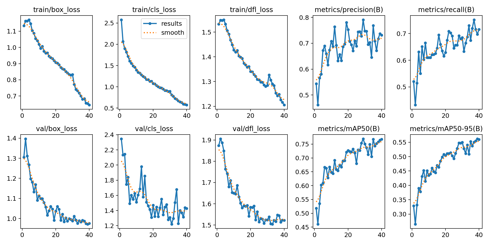
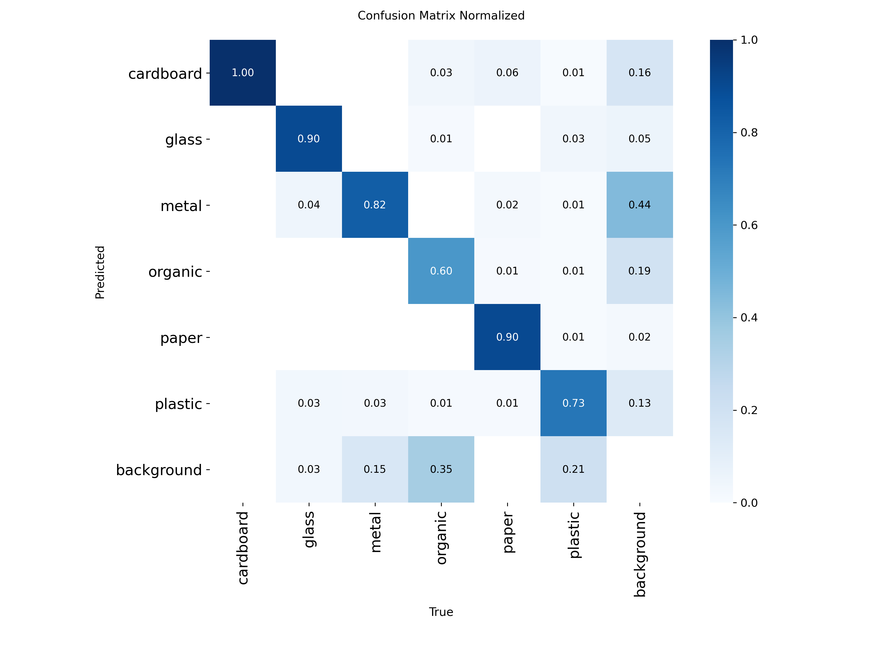
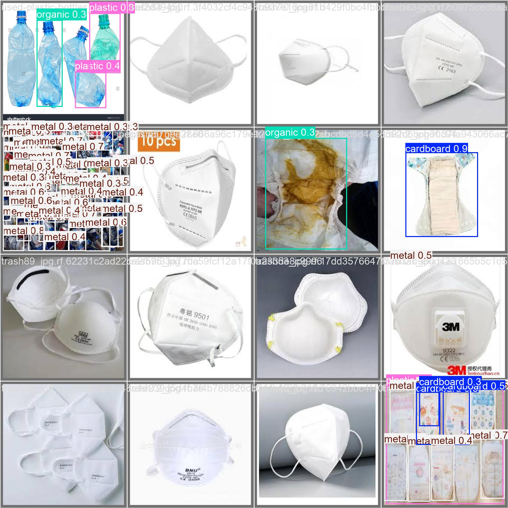

# AI-Powered Waste Detection & Dry vs. Wet Waste Segregation (YOLOv8)

[](https://opensource.org/licenses/MIT)
[](https://www.python.org/downloads/release/python-3115/)
[](https://github.com/ultralytics/ultralytics)
[](https://pytorch.org/)

An automated computer vision system for real-time solid waste localization, 6-class material identification, and automated **Dry vs. Wet Waste stream segregation with composition percentage analytics**. Built on top of Ultralytics YOLOv8.

---

## Table of Contents
1. [Project Overview](#1-project-overview)
2. [Problem Statement](#2-problem-statement)
3. [Project Objectives](#3-project-objectives)
4. [Key Features](#4-key-features)
5. [System Architecture](#5-system-architecture)
6. [YOLOv8 Model Details](#6-yolov8-model-details)
7. [Detection Classes & Waste Categories](#7-detection-classes--waste-categories)
8. [Dry vs. Wet Segregation Methodology](#8-dry-vs-wet-segregation-methodology)
9. [Dataset Attribution & Structure](#9-dataset-attribution--structure)
10. [Dataset Split & Distribution](#10-dataset-split--distribution)
11. [Training Configuration & Hyperparameters](#11-training-configuration--hyperparameters)
12. [Verified Evaluation Metrics](#12-verified-evaluation-metrics)
13. [Installation Guide](#13-installation-guide)
14. [Model Weights](#14-model-weights)
15. [Running Inference](#15-running-inference)
16. [Training the Model](#16-training-the-model)
17. [Sample Output & Visualizations](#17-sample-output--visualizations)
18. [Limitations & Future Scope](#18-limitations--future-scope)
19. [Credits & Licensing](#19-credits--licensing)

---

## 1. Project Overview

Improper solid waste segregation is one of the largest challenges facing modern municipal recycling facilities and smart cities. This project implements a single-stage deep learning object detection pipeline that detects individual waste items in mixed environments, classifies each into specific material categories, and translates granular detections into actionable municipal waste management metrics (**Dry Waste** vs. **Wet Waste** item counts and percentage shares).

---

## 2. Problem Statement

Manual sorting of municipal solid waste is hazardous, slow, and resource-intensive. Existing municipal bins often suffer from cross-contamination between organic (biodegradable/wet) and recyclable (dry) materials. To automate robotic sorting arms or provide automated sorting analytics for smart bins, an AI vision system must reliably detect overlapping, damaged, and varied waste items in real-time and classify them accurately.

---

## 3. Project Objectives

- **Multi-Class Detection**: Detect and delineate bounding boxes around 6 material types: cardboard, glass, metal, organic, paper, and plastic.
- **Municipal Waste Categorization**: Group multi-class objects into standard municipal waste streams (Dry vs. Wet).
- **Composition Analytics**: Calculate total item counts, category distributions, and percentage share of Dry vs. Wet waste.
- **Cross-Platform & Headless Support**: Provide robust CLI and programmatic interfaces compatible with desktop GUI displays as well as headless cloud servers and Docker environments.

---

## 4. Key Features

- **Ultralytics YOLOv8 Architecture**: Lightweight nano-variant (`yolov8n`) offering fast inference speeds on standard CPUs and high throughput on CUDA GPUs.
- **Automated Segregation Report**: Instant calculation of Dry Waste % and Wet Waste % from detected items.
- **Headless-Safe Visualization**: Saves high-resolution bounding box annotations directly to disk without requiring a physical monitor or graphical window server.
- **Modular Codebase**: Clean separation of inference (`src/predict.py`), training (`src/train.py`), and statistical calculation utilities (`src/utils.py`).
- **Flexible Input Sources**: Supports single images, image batches, and video feeds via CLI arguments.

---

## 5. System Architecture

```text
[ Input Image / Video / Directory ]
                │
                ▼
     [ YOLOv8n Inference Engine ]
    (Weights: my_waste_model_6_class.pt)
                │
                ▼
   [ Bounding Boxes & Confidence Scores ]
   ├── Cardboard (Dry)
   ├── Glass     (Dry)
   ├── Metal     (Dry)
   ├── Organic   (Wet)
   ├── Paper     (Dry)
   └── Plastic   (Dry)
                │
                ▼
[ Segregation & Composition Analyzer ]
   ├── Total item aggregation
   ├── Dry vs. Wet classification mapping
   └── Dry% and Wet% computation
                │
                ▼
      [ Outputs & Artifacts ]
   ├── Formatted terminal report
   ├── Annotated image saved to output/
   └── Optional desktop display window
```

---

## 6. YOLOv8 Model Details

- **Model Variant**: YOLOv8 Nano (`yolov8n`)
- **Total Parameters**: 3,012,018 (~3.01 Million parameters)
- **Strides**: 3 detection scale strides: `8`, `16`, `32`
- **Input Resolution**: $640 \times 640$ pixels
- **Model Checkpoint Size**: 5.96 MB (`my_waste_model_6_class.pt`)
- **Base Pretrained Weights**: `yolov8n.pt` (MS COCO 80-class checkpoint)
- **Transfer Learning Method**: Full backbone and neck fine-tuning on custom 6-class waste dataset.

---

## 7. Detection Classes & Waste Categories

| Class ID | Class Name | Target Stream | Example Waste Items |
| :---: | :--- | :---: | :--- |
| `0` | **Cardboard** | **DRY** | Shipping cartons, cereal boxes, corrugated packaging |
| `1` | **Glass** | **DRY** | Bottles, jars, broken glassware |
| `2` | **Metal** | **DRY** | Beverage cans, tin foil, food tins, scrap hardware |
| `3` | **Organic** | **WET** | Food scraps, fruit peels, biological waste, leaves |
| `4` | **Paper** | **DRY** | Newspapers, receipts, office documents, flyers |
| `5` | **Plastic** | **DRY** | Water bottles, food containers, polythene bags |

---

## 8. Dry vs. Wet Segregation Methodology

Municipal waste management protocols classify decomposable/compostable material as **Wet Waste** and recyclables as **Dry Waste**. The application translates detected bounding boxes into this binary distribution:

$$\text{Wet Count} = \sum \text{Organic items}$$
$$\text{Dry Count} = \sum (\text{Cardboard} + \text{Glass} + \text{Metal} + \text{Paper} + \text{Plastic})$$
$$\text{Total Count} = \text{Dry Count} + \text{Wet Count}$$

$$\text{Dry Waste \%} = \left(\frac{\text{Dry Count}}{\text{Total Count}}\right) \times 100$$
$$\text{Wet Waste \%} = \left(\frac{\text{Wet Count}}{\text{Total Count}}\right) \times 100$$

---

## 9. Dataset Attribution & Structure

The dataset originates from **Roboflow Universe**:
- **Dataset Name**: Waste Classificator (v5)
- **Provider**: deep-learning-group-project
- **URL**: [https://universe.roboflow.com/deep-learning-group-project/waste-classificator-mlabt/dataset/5](https://universe.roboflow.com/deep-learning-group-project/waste-classificator-mlabt/dataset/5)
- **License**: [Creative Commons Attribution 4.0 International (CC BY 4.0)](https://creativecommons.org/licenses/by/4.0/)

### Preprocessing & Augmentations (Roboflow Export)
- Auto-orientation of pixel data (EXIF-orientation stripped).
- Resized to $640 \times 640$ pixels.
- 3 versions created per source image using:
  - 90-degree rotations (none, clockwise, counter-clockwise).
  - Brightness variations ($\pm 16\%$).
  - Salt-and-pepper noise applied to 1.73% of pixels.

---

## 10. Dataset Split & Distribution

| Split | Images | Bounding Boxes | Cardboard | Glass | Metal | Organic | Paper | Plastic |
| :--- | :---: | :---: | :---: | :---: | :---: | :---: | :---: | :---: |
| **Train** | 3,981 | 7,290 | 978 | 1,068 | 1,368 | 1,482 | 999 | 1,395 |
| **Valid** | 328 | 524 | 10 | 68 | 117 | 92 | 89 | 148 |
| **Test** | 216 | 396 | 117 | 16 | 80 | 62 | 37 | 84 |
| **TOTAL** | **4,525** | **8,210** | **1,105** | **1,152** | **1,565** | **1,636** | **1,125** | **1,627** |

---

## 11. Training Configuration & Hyperparameters

Extracted from verified training experiment logs (`runs/detect/train2/args.yaml`):

- **Base Weights**: `yolov8n.pt`
- **Epochs**: 40
- **Batch Size**: 8
- **Image Resolution**: $640 \times 640$
- **Optimizer**: `auto` (Stochastic Gradient Descent / AdamW)
- **Initial Learning Rate (`lr0`)**: `0.01`
- **Final Learning Rate (`lrf`)**: `0.01`
- **Momentum**: `0.937`
- **Weight Decay**: `0.0005`
- **Warmup Epochs**: `3.0`
- **IoU Threshold for NMS**: `0.7`
- **Data Augmentations**: Mosaic (`1.0`), Horizontal Flip (`0.5`), Random Erasing (`0.4`), Color Jitter HSV-H (`0.015`), HSV-S (`0.7`), HSV-V (`0.4`).
- **Close Mosaic**: Applied during the last 10 epochs.
- **Hardware & Runtime**: NVIDIA GPU acceleration, completed in **1,349.35 seconds (~22.5 minutes)**.

---

## 12. Verified Evaluation Metrics

Metrics verified from training logs (`results.csv` and model checkpoint `my_waste_model_6_class.pt` at best fitness **Epoch 39**):

| Evaluation Metric | Best Checkpoint Score (Epoch 39) | Final Epoch 40 Score |
| :--- | :---: | :---: |
| **Precision ($P$)** | **73.74%** (`0.73736`) | 73.13% (`0.73133`) |
| **Recall ($R$)** | **69.71%** (`0.69708`) | 71.56% (`0.71562`) |
| **mAP@50** | **76.46%** (`0.76463`) | 76.77% (`0.76765`) |
| **mAP@50-95** | **56.18%** (`0.56178`) | 55.95% (`0.55945`) |
| **Validation Box Loss** | `0.97186` | `0.97519` |
| **Validation Class Loss**| `1.43793` | `1.42806` |
| **Validation DFL Loss** | `1.52291` | `1.52287` |

### Training & Validation Loss Curves


### Normalized Confusion Matrix


---

## 13. Installation Guide

### Prerequisites
- Python 3.10 or 3.11
- Git
- NVIDIA GPU with CUDA drivers (optional, for accelerated inference/training)

### Setup
1. Clone the repository:
   ```bash
   git clone https://github.com/<your-username>/waste-segregation-yolov8.git
   cd waste-segregation-yolov8
   ```

2. Create and activate a virtual environment:
   ```bash
   python -m venv venv
   # On Windows:
   venv\Scripts\activate
   # On Linux/macOS:
   source venv/bin/activate
   ```

3. Install required dependencies:
   ```bash
   pip install --upgrade pip
   pip install -r requirements.txt
   ```

---

## 14. Model Weights

The custom fine-tuned model checkpoint is stored in `weights/my_waste_model_6_class.pt` (5.96 MB).
For repository releases, checkpoints can be downloaded via GitHub Releases or placed directly into the `weights/` directory.

To verify model checkpoint integrity in Python:
```python
from ultralytics import YOLO

model = YOLO("weights/my_waste_model_6_class.pt")
print("Detected Classes:", model.names)
```

---

## 15. Running Inference

### Predict on a Sample Image
```bash
python src/predict.py --source assets/sample_images/047.jpg --weights weights/my_waste_model_6_class.pt
```

### Predict with Custom Confidence and Save Directory
```bash
python src/predict.py --source assets/sample_images/024.jpg --conf 0.30 --save-dir output
```

### Predict on an Entire Directory of Images
```bash
python src/predict.py --source assets/sample_images/ --save-dir output
```

### Interactive Desktop GUI Window
If running locally on a system with a monitor / GUI:
```bash
python src/predict.py --source assets/sample_images/047.jpg --show
```

### Sample Terminal Output
```text
=========================================
       WASTE SEGREGATION REPORT          
=========================================
Total items detected : 4
  - Dry Waste items  : 3
  - Wet Waste items  : 1
-----------------------------------------
  Dry Waste Composition : 75.00%
  Wet Waste Composition : 25.00%
-----------------------------------------
Class Breakdown:
  * cardboard  :   1 items (DRY)
  * plastic    :   2 items (DRY)
  * organic    :   1 items (WET)
=========================================
[INFO] Annotated visualization saved to: output/annotated_047.jpg
```

---

## 16. Training the Model

To retrain or fine-tune YOLOv8 from scratch on the dataset:

1. Download the dataset into the repository root following [data/README.md](data/README.md).
2. Start training using `src/train.py`:
   ```bash
   python src/train.py --data data/data.yaml --model yolov8n.pt --epochs 40 --batch 8 --imgsz 640
   ```
3. Custom weights will be automatically exported to `weights/my_waste_model_6_class.pt`.

---

## 17. Sample Output & Visualizations

Validation predictions showing ground truth vs. predicted detections from training validation:



---

## 18. Limitations & Future Scope

### Current Limitations
- **Binary Stream Simplification**: Currently classifies all non-organic waste as Dry Waste; certain contaminated dry items (e.g., grease-stained cardboard) should ideally be composted or landfilled.
- **Occlusion & Cluttered Scenes**: Heavily overlapping or buried waste items can experience lower recall.
- **Single-view 2D Imagery**: Bounding boxes provide item counts rather than volume or mass/weight estimates.

### Future Roadmap
- [ ] Add instance segmentation (YOLOv8-Seg) to compute pixel-level surface area and approximate volumetric fill ratios.
- [ ] Implement camera stream support for real-time edge processing on Raspberry Pi / NVIDIA Jetson smart bins.
- [ ] Expand class taxonomy to support E-Waste and Hazardous / Medical Waste streams.
- [ ] Deploy a containerized FastAPI backend with a lightweight web dashboard.

---

## 19. Credits & Licensing

- **Code License**: [MIT License](LICENSE) (c) 2026.
- **Dataset**: Provided by `deep-learning-group-project` on Roboflow Universe, licensed under [CC BY 4.0](https://creativecommons.org/licenses/by/4.0/).
- **YOLOv8 Architecture**: [Ultralytics](https://github.com/ultralytics/ultralytics).

